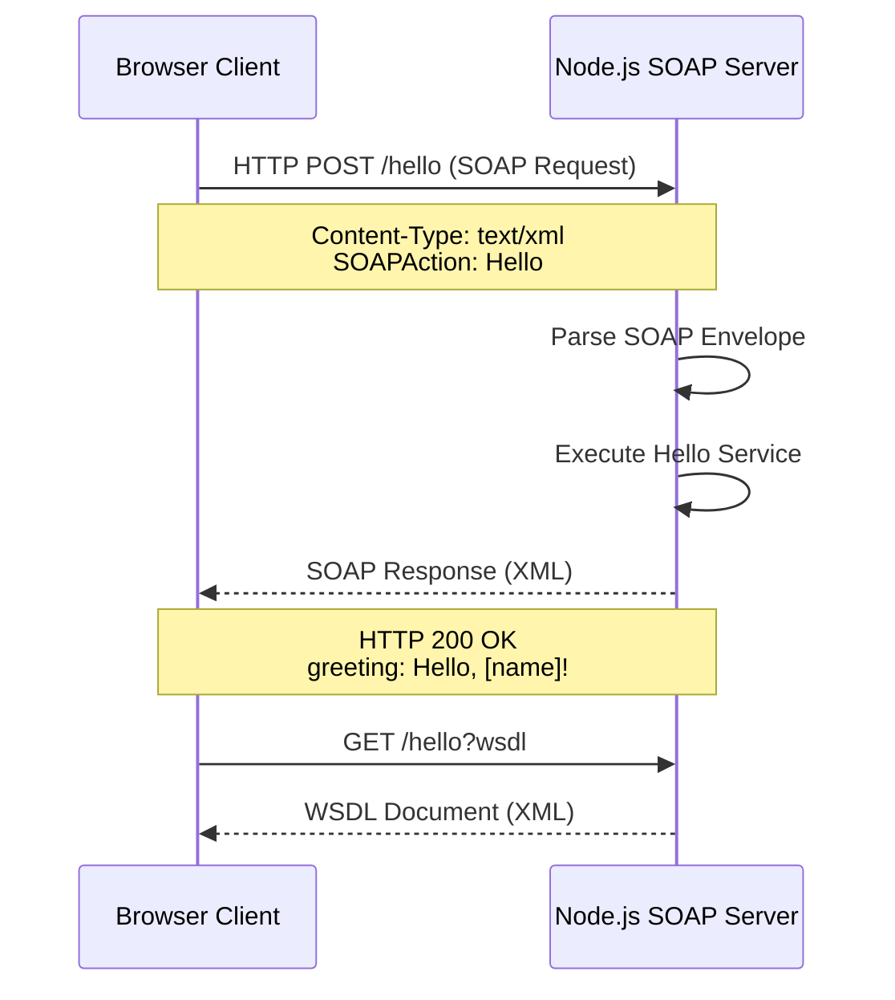

# SOAP Hello Service Demo

This project demonstrates a simple SOAP API implementation using Node.js with a web client.

## Architecture



## How It Works

### Server Side (`index.js`)

1. **HTTP Server**: Creates a basic Node.js HTTP server that listens on port 8000
2. **SOAP Service**: The `soap` library attaches a SOAP service to the `/hello` endpoint
3. **WSDL**: The Web Services Description Language (WSDL) defines the service contract - what operations are available and their input/output formats
4. **Service Implementation**: The `Hello` function receives the `name` parameter and returns a greeting object

### Client Side (`index.html`)

1. **SOAP Envelope**: The browser constructs a SOAP XML envelope with the user's input
2. **HTTP POST**: Sends the XML to `http://localhost:8000/hello` with headers:
   - `Content-Type: text/xml` - identifies the body as XML
   - `SOAPAction: Hello` - specifies which operation to invoke
3. **Response Parsing**: The browser parses the XML response and extracts the `greeting` element

### SOAP Message Flow

1. Client builds XML request → 2. HTTP POST to server → 3. Server parses XML → 4. Server executes service logic → 5. Server returns XML response → 6. Client displays result

## Features

- **SOAP Server**: Simple Node.js SOAP service with one operation
- **Operation**: `Hello` - returns a greeting message
- **WSDL**: Web Services Description Language document
- **Web Client**: Basic HTML client to test the SOAP API

## Quick Start

### 1. Install Dependencies
```bash
npm install
```

### 2. Start the Server
```bash
npm start
```

### 3. Access the Application

- **Client UI**: http://localhost:8000/
- **SOAP Endpoint**: http://localhost:8000/hello
- **WSDL**: http://localhost:8000/hello?wsdl

## API Operation

| Operation | Parameters | Description |
|-----------|------------|-------------|
| `Hello` | `name` (string) | Returns a greeting message |

## Example SOAP Request

```xml
<?xml version="1.0" encoding="UTF-8"?>
<soap:Envelope xmlns:soap="http://schemas.xmlsoap.org/soap/envelope/"
               xmlns:tns="http://example.com/hello">
  <soap:Body>
    <tns:HelloRequest>
      <name>World</name>
    </tns:HelloRequest>
  </soap:Body>
</soap:Envelope>
```

## Example SOAP Response

```xml
<?xml version="1.0" encoding="UTF-8"?>
<soap:Envelope xmlns:soap="http://schemas.xmlsoap.org/soap/envelope/">
  <soap:Body>
    <HelloResponse>
      <greeting>Hello, World!</greeting>
    </HelloResponse>
  </soap:Body>
</soap:Envelope>
```
